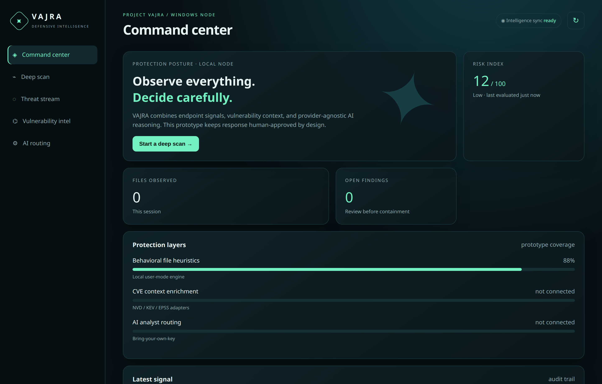
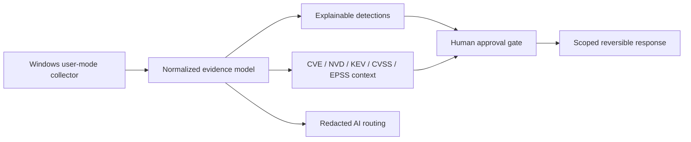

<div align="center">

# ✦ VAJRA

### Defensive intelligence with receipts.

**Evidence-led endpoint risk, detection, and response for Windows.**

[](https://github.com/mehulvyas911-eng/vajra-security/actions/workflows/windows-build.yml)
[](https://github.com/mehulvyas911-eng/vajra-security/releases)
[](https://github.com/mehulvyas911-eng/vajra-security/releases)
[](https://github.com/mehulvyas911-eng/vajra-security/releases)
[](https://www.electronjs.org/)
[](docs/SECURITY_BOUNDARIES.md)

[Download VAJRA](https://github.com/mehulvyas911-eng/vajra-security/releases/latest) · [Read the research brief](docs/VAJRA_RESEARCH_BRIEF.md) · [View the roadmap](#roadmap)

</div>



> **VAJRA is a working defensive prototype, not a certified antivirus or EDR.** It does not claim to stop every attack. It is built around a more useful promise: make security decisions explainable, evidence-backed, and controlled by humans.

> **Launch goal:** help us reach **4,300 genuine downloads** of the Windows prototype. The goal badge is aspirational; release assets and download activity remain visible on GitHub.

## Why VAJRA exists

Endpoint security is no longer just a file-scanning problem. Living-off-the-land execution, identity and token abuse, software supply-chain risk, trusted cloud services, insider misuse, and vulnerability context all cross the boundary of a traditional antivirus verdict.

VAJRA is designed as a correlation layer that brings those signals together without turning uncertainty into false confidence.

```text
┌──────────────────────┐     ┌──────────────────────┐
│ Endpoint behaviour   │────▶│                      │
│ process · script     │     │                      │
├──────────────────────┤     │                      │
│ Identity + cloud     │────▶│   VAJRA evidence     │──────▶  Explainable decision
│ user · token · SaaS  │     │   and response       │        with receipts
├──────────────────────┤     │                      │
│ Vulnerability context│────▶│                      │
│ CVE · KEV · EPSS     │     └──────────────────────┘
└──────────────────────┘
```

## What is in the 0.1 prototype

| Surface | Current capability |
|---|---|
| Command center | Risk posture, protection layers, latest signals, and audit-oriented status |
| Deep scan | Bounded, read-only local folder scan with transparent heuristics |
| Evidence | SHA-256 hashes, paths, signal reasons, severity, and review state |
| Threat stream | Evidence ledger designed for future containment workflows |
| Vulnerability intel | Separate CVE, NVD, CISA KEV, CVSS, EPSS, and local-evidence concepts |
| AI routing | OpenRouter, Anthropic Claude, Google Gemini, and OpenAI-compatible endpoints |
| Safety boundary | No execution, deletion, killing, isolation, or arbitrary malware reversal |

## Product principles

### Observe before you act

Preserve hashes, timestamps, provenance, detector version, confidence, and collection gaps before high-impact response. A detection without evidence is a notification; a detection with evidence can become a case.

### Keep signals separate

A CVE identifier is not local exposure. KEV is known-exploitation context. EPSS is a forecast. CVSS communicates severity. Local inventory, version, configuration, reachability, patch state, and telemetry decide what is actionable.

### Human-approved response

Quarantine, isolation, deletion, reboot, rollback, and broad policy changes can cause operational or forensic harm. VAJRA’s direction is reversible, scoped, rate-limited, logged response — with human approval for high-impact actions.

### AI as an analyst, not an authority

Provider-agnostic routing is useful only when the model receives the minimum necessary evidence, cites its sources, exposes uncertainty, and cannot silently turn a recommendation into a destructive action.

## Quick start

```bash
npm install
npm start
```

The app runs as an Electron desktop window. Choose **Deep scan**, select a folder, and run the bounded read-only scan.

## Download the Windows installer

The current unsigned Windows x64 installer is available from the [latest GitHub release](https://github.com/mehulvyas911-eng/vajra-security/releases/latest).

To build it yourself on Windows or through GitHub Actions:

```bash
npm ci
npm run dist:win
```

The installer is written to `release/`. The repository includes [`.github/workflows/windows-build.yml`](.github/workflows/windows-build.yml), which uploads the installer as a workflow artifact. The `0.1.0` release also includes `SHA256SUMS.txt`.

> Windows SmartScreen may warn because the prototype release is not Authenticode-signed yet.

## Architecture direction



**Phase 1:** standard-user collector, AMSI/Event Log/ETW integrations, bounded queues, loss metrics, explainable detections, vulnerability context, safe sample handling, and audit logging.

**Phase 2:** administrator-managed enrollment, optional Sysmon ingestion, fleet policy, cloud identity/SaaS/DNS/proxy context, SBOM and supplier lineage.

**Phase 3:** privileged telemetry and advanced response only where a documented coverage gap remains.

**Phase 4:** kernel or driver capability only if necessary, with separate threat modeling, Microsoft-compliant signing, compatibility testing, rollback safety, and independent review.

## Roadmap

- [x] Electron command center and Windows packaging path
- [x] Bounded read-only scanner with SHA-256 evidence
- [x] AI provider routing UI
- [x] CVE / KEV / EPSS product model
- [x] Evidence-first security boundaries and research brief
- [ ] Windows Event Log and AMSI adapters
- [ ] ETW collector with bounded queues and event-loss metrics
- [ ] Signed update channel and Authenticode release
- [ ] Local SBOM/package inventory and applicability matching
- [ ] Pilot benchmark harness for false positives, triage time, and forensic completeness
- [ ] Administrator-managed enrollment and scoped response service

## Responsible use

VAJRA is defensive software. Do not use it to develop malware, steal credentials, evade security controls, or automate destructive response. Contributions must preserve evidence, minimize privilege, constrain blast radius, and keep high-impact actions under explicit policy and human approval.

Before deploying beyond a prototype, complete an independent threat model, privacy review, code-signing setup, update-channel review, benign-corpus testing, false-positive measurement, and Windows compatibility testing.

## Documentation

- [Research and product brief](docs/VAJRA_RESEARCH_BRIEF.md) — endpoint gaps, CVE intelligence, Windows interfaces, response safety, and positioning
- [Marketing and go-to-market plan](docs/MARKETING_PLAN.md) — wedge, proof metrics, channels, and claims to avoid
- [Security boundaries](docs/SECURITY_BOUNDARIES.md) — current limits and safe architecture direction
- [Release v0.1.0](https://github.com/mehulvyas911-eng/vajra-security/releases/tag/v0.1.0) — installer and checksum

## License

The repository is public for transparency and collaboration. A permissive open-source license has not yet been selected; until one is added, all rights are reserved by the copyright holder.

<div align="center">

**No hype. No invisible decisions. No destructive autonomy by default.**

</div>
